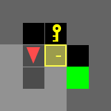
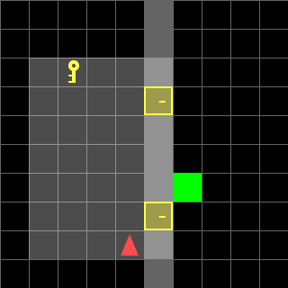

# Door-Key Planning with Dynamic Programming

**UC San Diego ECE 276B · Project 1**

A grid-world robot must find a key, unlock a door, and reach a goal. This project builds a cost-aware policy from the robot's position, heading, key state, and door state, then uses it to solve both fixed and variable Door-Key maps.

| Known map | Variable map |
| --- | --- |
|  |  |

## What it does

- **Known layouts:** value iteration over `(column, row, heading, has_key, door_open)` to choose actions with the lowest cumulative cost.
- **Variable layouts:** one policy over an expanded state that includes the key location, goal location, and two door states. The policy is reused across 36 generated 10×10 configurations.
- **Reproducible output:** environment generation and planning produce GIFs for all 7 fixed maps and 36 variable maps. Both groups were run locally before publication.

The action space includes forward, turn left, turn right, pick up key, and unlock door. The planner checks walls and doors when computing transitions. GIFs show the resulting action sequences in MiniGrid.

## Run it

Use Python 3.11 or 3.12 from the repository root:

```bash
python -m venv .venv
source .venv/bin/activate  # Windows PowerShell: .venv\Scripts\Activate.ps1
python -m pip install -r requirements.txt
python create_env.py
python doorkey.py --part known
python doorkey.py --part random
```

Activate the virtual environment for your platform before installing dependencies.

`create_env.py` writes 44 map snapshots and serialized environments to `envs/`: 7 solved fixed layouts, 1 additional example layout, and 36 variable layouts. The solver writes 43 animations to `gif/`. These generated directories are ignored by Git. The `.env` files use Python pickle; load only files you generated or otherwise trust.

## Code

| File | Role |
| --- | --- |
| `doorkey.py` | State transitions, dynamic programming, and both solvers |
| `create_env.py` | Generates the 7 fixed and 36 variable environments |
| `utils.py` | Map loading, action costs, and GIF rendering |
| `media/` | Selected outputs for a quick preview |

The MiniGrid environment generation and visualization utilities are adapted from the ECE 276B project starter materials; the planning logic is in `doorkey.py`.

**Next project:** [3D Motion Planning and Replanning](https://github.com/michaelyuuu/ECE-276B_3D-Motion-Planning) · [Robot Trajectory Tracking](https://github.com/michaelyuuu/ECE-276B_Robot-Trajectory-Tracking)
